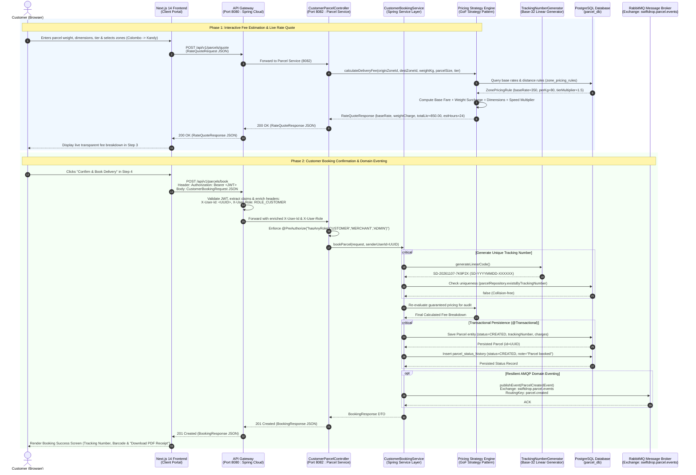

# Flow 1: Customer Delivery Booking & Fee Estimation Sequence Diagram

This technical design document outlines the end-to-end architecture, interaction flow, and data contracts for **Flow 1: Customer Delivery Booking & Fee Estimation** in the SwiftDrop parcel logistics microservice ecosystem.

---

## 1. Sequence Diagram



---

## 2. Component & Architecture Breakdown

### 2.1 Participating Actors & Components
1. **Customer (Browser / Mobile)**: The authenticated end-user operating the responsive Next.js Customer Portal.
2. **Next.js 14 Frontend Client**: Manages client-side wizard state across 4 distinct steps, debounces rate quote queries, and formats currency in Sri Lankan Rupees (LKR).
3. **API Gateway (`api-gateway`, Port 8080)**: Single entry point handling TLS termination, JWT token validation, rate limiting, and header enrichment (`X-User-Id`, `X-User-Role`, `X-User-Email`).
4. **Customer Parcel Controller (`CustomerParcelController`, Port 8082)**: Thin REST controller validating input payload constraints, enforcing `@PreAuthorize` role access, and returning RFC 7807 `ProblemDetail` on errors.
5. **Customer Booking Service (`CustomerBookingServiceImpl`)**: Transactional service orchestrating tracking code generation, domain pricing execution, parcel entity assembly, audit history logging, and domain event publication.
6. **Dynamic Pricing Strategy Engine (`ZonePricingStrategyEngine`)**: Applies the Gang of Four (GoF) Strategy Pattern to calculate deterministic delivery fees based on weight, dimensions, zone distances, and service speed tiers.
7. **Linear Tracking Number Generator (`TrackingNumberGenerator`)**: High-throughput cryptographic generator producing human-readable, unambiguous base-32 tracking numbers formatted as `SD-YYYYMMDD-XXXXXX` (omitting confusing characters `0, O, 1, I`).
8. **PostgreSQL Database (`parcel_db`, Port 5432)**: Relational datastore maintaining ACID guarantees for `parcels`, `delivery_zones`, `zone_pricing_rules`, and `parcel_status_history`.
9. **RabbitMQ Message Broker (Port 5672)**: Enterprise message broker distributing the `parcel.created` event via topic exchange `swiftdrop.parcel.events` to downstream listeners (dispatch unassigned queues, notification dispatchers, webhook retry engines).

---

## 3. Data Contracts & Payloads

### 3.1 Rate Quote Request (`POST /api/v1/parcels/quote`)
```json
{
  "originZoneId": "a1b2c3d4-0001-4000-8000-000000000001",
  "destinationZoneId": "a1b2c3d4-0002-4000-8000-000000000002",
  "weightKg": 2.50,
  "parcelSize": "MEDIUM",
  "deliveryTier": "EXPRESS"
}
```

### 3.2 Rate Quote Response (`200 OK`)
```json
{
  "baseRate": 350.00,
  "weightSurcharge": 120.00,
  "sizeSurcharge": 50.00,
  "tierMultiplier": 1.5,
  "totalEstimatedFee": 780.00,
  "currency": "LKR",
  "estimatedDeliveryHours": 24
}
```

### 3.3 Customer Booking Request (`POST /api/v1/parcels/book`)
```json
{
  "senderName": "Saman Kumara",
  "senderPhone": "0771234567",
  "senderAddress": "No. 45, Galle Road, Colombo 03",
  "recipientName": "Kasun Perera",
  "recipientPhone": "0719876543",
  "recipientAddress": "No. 12, Peradeniya Road, Kandy",
  "originZoneId": "a1b2c3d4-0001-4000-8000-000000000001",
  "destinationZoneId": "a1b2c3d4-0002-4000-8000-000000000002",
  "weightKg": 2.50,
  "parcelSize": "MEDIUM",
  "deliveryTier": "EXPRESS",
  "specialInstructions": "Handle with care - fragile electronics"
}
```

### 3.4 Customer Booking Response (`201 Created`)
```json
{
  "parcelId": "c3d4e5f6-7890-4abc-def0-123456789abc",
  "trackingNumber": "SD-20261107-7K9P2X",
  "status": "CREATED",
  "originZoneName": "Western Province (Colombo Zone)",
  "destinationZoneName": "Central Province (Kandy Zone)",
  "totalChargeLkr": 780.00,
  "deliveryTier": "EXPRESS",
  "estimatedDeliveryDate": "2026-11-08T18:00:00Z",
  "createdAt": "2026-11-07T10:30:00Z"
}
```

---

## 4. Error Handling & Edge Cases
- **Zone Inactivity:** If either the origin or destination zone is marked inactive, `GlobalExceptionHandler` produces HTTP 400 Bad Request with RFC 7807 problem details (`"Zone is not operational"`).
- **Tracking Number Collision Avoidance:** Up to 5 collision retries with backoff ensure uniqueness even during peak concurrent booking bursts.
- **AMQP Broker Outage Resilience:** When RabbitMQ is unreachable, message publishing is caught and logged at `ERROR` level without aborting the transactional parcel booking commit, guaranteeing customer order durability.

