# Flow 2: Merchant Automated API Order Creation & Bulk Ingestion Sequence Diagram

This technical design document outlines the end-to-end architecture, Machine-to-Machine (M2M) interaction flow, and data contracts for **Flow 2: Merchant Automated API Order Creation & Bulk Ingestion** in the SwiftDrop parcel logistics microservice ecosystem.

---

## 1. Sequence Diagram

```mermaid
sequenceDiagram
    autonumber
    actor MerchantStore as Partner E-Commerce Server<br/>(e.g., Daraz / Kapruka)
    participant Gateway as API Gateway<br/>(Port 8080 : Spring Cloud Gateway)
    participant AuthController as OAuthTokenController<br/>(Port 8081 : Auth Service)
    participant MerchantAuthSvc as MerchantAuthService<br/>(Spring Service Layer)
    participant AuthDB as PostgreSQL Database<br/>(auth_db)
    participant ParcelController as MerchantParcelController<br/>(Port 8082 : Parcel Service)
    participant BulkOrderSvc as BulkOrderService<br/>(Transactional Ingestion Engine)
    participant MerchantOrderSvc as MerchantOrderService<br/>(Business Logic Layer)
    participant PricingEngine as Dynamic Pricing Engine<br/>(MerchantDiscountPricingStrategy)
    participant Generator as TrackingNumberGenerator<br/>(Linear Base-32 Generator)
    participant ParcelDB as PostgreSQL Database<br/>(parcel_db)
    participant RabbitMQ as RabbitMQ Message Broker<br/>(Exchange: swiftdrop.events.topic)

    %% ------------------------------------------------------------------------
    %% Phase 1: Machine-to-Machine OAuth 2.0 Token Acquisition
    %% ------------------------------------------------------------------------
    rect rgb(240, 248, 255)
    note over MerchantStore, AuthDB: Phase 1: OAuth 2.0 Client Credentials Grant (M2M Authentication)
    MerchantStore->>Gateway: POST /api/v1/auth/oauth/token<br/>Body: grant_type=client_credentials&client_id=...&client_secret=...
    Gateway->>AuthController: Route to auth-service (8081)
    AuthController->>MerchantAuthSvc: generateM2mToken(OAuthTokenRequest)
    MerchantAuthSvc->>AuthDB: Query Merchant by oauth_client_id
    AuthDB-->>MerchantAuthSvc: Merchant Entity (Status: ACTIVE, BCrypt Secret Hash)
    MerchantAuthSvc->>MerchantAuthSvc: BCrypt passwordEncoder.matches(clientSecret, secretHash)
    MerchantAuthSvc->>MerchantAuthSvc: Issue Bearer JWT (claims: sub=userId, role=ROLE_MERCHANT, merchantId=UUID)
    MerchantAuthSvc-->>AuthController: OAuthTokenResponse (access_token, token_type=Bearer, expires_in=900)
    AuthController-->>Gateway: 200 OK (OAuthTokenResponse JSON)
    Gateway-->>MerchantStore: 200 OK (Bearer JWT Access Token)
    end

    %% ------------------------------------------------------------------------
    %% Phase 2: Perimeter Gateway Header Enrichment & Role Enforcement
    %% ------------------------------------------------------------------------
    rect rgb(255, 250, 240)
    note over MerchantStore, ParcelController: Phase 2: Gateway Perimeter Claim Extraction & Request Routing
    MerchantStore->>Gateway: POST /api/v1/parcels/bulk (or /parcels/merchant/orders)<br/>Header: Authorization: Bearer <JWT><br/>Body: BulkOrderRequest (up to 100 delivery orders)
    Gateway->>Gateway: Validate JWT signature & expiration
    Gateway->>Gateway: Extract claims: inject X-Merchant-Id, X-User-Role, X-User-Id
    Gateway->>Gateway: RoleAuthorizationFilter: Verify ROLE_MERCHANT
    Gateway->>ParcelController: Forward to parcel-service (8082) with injected context headers
    end

    %% ------------------------------------------------------------------------
    %% Phase 3: Transactional Batch Ingestion & Dynamic 15% Corporate Discounting
    %% ------------------------------------------------------------------------
    rect rgb(245, 255, 245)
    note over ParcelController, ParcelDB: Phase 3: 15% Discount Pricing, Collision-Free Identifiers & Persistence
    ParcelController->>BulkOrderSvc: processBulkOrders(request, merchantId, senderUserId)
    BulkOrderSvc->>BulkOrderSvc: Validate batch size (<= 100 orders)

    loop For Each Delivery Order in Batch (1..N <= 100)
        BulkOrderSvc->>MerchantOrderSvc: createMerchantOrder(row, merchantId, senderUserId)
        MerchantOrderSvc->>PricingEngine: calculateQuote(tier=MERCHANT, originZone, destZone, weight)
        PricingEngine->>PricingEngine: Apply MerchantDiscountPricingStrategy<br/>(15% discount on baseRate & ratePerKg)
        PricingEngine-->>MerchantOrderSvc: ParcelQuoteResponse (discountedFee, discountAmount, zoneSurcharge)
        
        MerchantOrderSvc->>Generator: generateUniqueTrackingNumber()
        Generator-->>MerchantOrderSvc: Tracking Number (SD-YYYYMMDD-XXXXXX)

        MerchantOrderSvc->>ParcelDB: INSERT into parcels (status=CREATED, merchant_id, tracking_number, estimated_fee)
        MerchantOrderSvc->>ParcelDB: INSERT into parcel_status_history (status=CREATED, note="B2B automated order")

        opt AMQP Asynchronous Event Notification
            MerchantOrderSvc->>RabbitMQ: publishEvent(ParcelCreatedEvent)<br/>Exchange: swiftdrop.events.topic, RoutingKey: parcel.created
            RabbitMQ-->>MerchantOrderSvc: ACK
        end

        MerchantOrderSvc-->>BulkOrderSvc: Row Success (trackingNumber, estimatedFee, status=SUCCESS)
    end

    BulkOrderSvc-->>ParcelController: BulkOrderResponse (totalReceived, successfulCount, failedCount, results[])
    ParcelController-->>Gateway: 201 Created (BulkOrderResponse JSON)
    Gateway-->>MerchantStore: 201 Created (BulkOrderResponse JSON with tracking numbers)
    end
```



---

## 2. Architectural Components & Responsibilities

| Component | Port / Layer | Primary Architectural Responsibilities |
| :--- | :--- | :--- |
| **Partner E-Commerce Store** | External Client | Authenticates machine-to-machine via OAuth 2.0 `client_credentials` and invokes headless REST APIs or batch file uploads. |
| **API Gateway (`api-gateway`)** | Edge (Port 8080) | Enforces TLS termination, JWT cryptographic signature verification, perimeter RBAC, and downstream header enrichment (`X-Merchant-Id`, `X-User-Role`, `X-User-Id`). Blocks external requests targeting `/internal/**`. |
| **OAuth Token Controller (`auth-service`)** | Edge / Auth (Port 8081) | Exposes `POST /api/v1/auth/oauth/token` accepting both `application/x-www-form-urlencoded` and `application/json` for RFC 6749 compliance. |
| **Merchant Auth Service (`MerchantAuthServiceImpl`)** | Business Logic | Validates merchant account active lifecycle status, verifies BCrypt hashes of client secrets, and issues signed stateless JWTs with embedded `merchantId`. |
| **Merchant Parcel Controller (`parcel-service`)** | Presentation (Port 8082) | Exposes `POST /api/v1/parcels/merchant/orders` and `POST /api/v1/parcels/bulk`, extracting injected `X-Merchant-Id` and delegating to transactional business services. |
| **Bulk Order Ingestion Engine (`BulkOrderServiceImpl`)** | Transactional Core | Manages batch ingestion bounded to $\le 100$ orders per payload, collects per-row execution outcomes, and returns comprehensive summaries without cascading aborts on single-row invalid data. |
| **GoF Pricing Strategy Engine (`PricingEngine`)** | Domain Logic | Automatically routes merchant requests to `MerchantDiscountPricingStrategy`, deducting a **15% contracted corporate discount** from base rates before applying size multipliers and zone surcharges. |
| **Tracking Number Generator (`TrackingNumberGenerator`)** | Domain Utility | Produces high-speed, collision-free linear tracking codes matching the canonical format `SD-YYYYMMDD-XXXXXX`. |
| **RabbitMQ Event Broker** | Messaging (Port 5672) | Distributes `parcel.created` events through topic exchange `swiftdrop.events.topic` to notification dispatchers and merchant webhook listeners. |

---

## 3. Data Contracts & Payloads

### 3.1 OAuth 2.0 Token Request (`POST /api/v1/auth/oauth/token`)

```http
POST /api/v1/auth/oauth/token HTTP/1.1
Host: api.swiftdrop.lk:8080
Content-Type: application/x-www-form-urlencoded

grant_type=client_credentials&client_id=mch_daraz_client_01&client_secret=sec_daraz_secret_2026
```

#### Token Response (`200 OK`)
```json
{
  "access_token": "eyJhbGciOiJIUzI1NiIsInR5cCI6IkpXVCJ9.eyJzdWIiOiJhMWIyYzNkNC1lNWY2LTdhOGItOWMwZC0xZTJmM2E0YjVjNmQiLCJyb2xlIjoiUk9MRV9NRVJDSEFOVCIsIm1lcmNoYW50SWQiOiJjMmQzZTRmNS1hNmI3LTg5MDEtY2RlZi0yMzQ1Njc4OTBhYmMiLCJleHAiOjE3NjI1MzUwMDB9...",
  "token_type": "Bearer",
  "expires_in": 900,
  "scope": "merchant:orders",
  "merchant_id": "c2d3e4f5-a6b7-8901-cdef-234567890abc"
}
```

---

### 3.2 Bulk Ingestion Request (`POST /api/v1/parcels/bulk`)

```http
POST /api/v1/parcels/bulk HTTP/1.1
Host: api.swiftdrop.lk:8080
Authorization: Bearer <M2M_ACCESS_TOKEN>
X-Merchant-Id: c2d3e4f5-a6b7-8901-cdef-234567890abc
Content-Type: application/json

{
  "orders": [
    {
      "originZoneId": 1,
      "destinationZoneId": 2,
      "pickupAddress": "Peliyagoda Central Hub, Warehouse 4",
      "dropoffAddress": "No. 42 Peradeniya Road, Kandy",
      "recipientName": "Kasun Jayawardena",
      "recipientPhone": "+94771234567",
      "weightKg": 2.5,
      "parcelSize": "MEDIUM",
      "merchantOrderReference": "DARAZ-ORD-8821"
    },
    {
      "originZoneId": 1,
      "destinationZoneId": 3,
      "pickupAddress": "Peliyagoda Central Hub, Warehouse 4",
      "dropoffAddress": "Galle Fort, Galle",
      "recipientName": "Anura Senanayake",
      "recipientPhone": "+94719876543",
      "weightKg": 1.2,
      "parcelSize": "SMALL",
      "merchantOrderReference": "DARAZ-ORD-8822"
    }
  ]
}
```

#### Bulk Ingestion Response (`201 Created`)
```json
{
  "totalReceived": 2,
  "successfulCount": 2,
  "failedCount": 0,
  "results": [
    {
      "rowNumber": 1,
      "trackingNumber": "SD-20261107-A4B7C9",
      "estimatedFee": 765.00,
      "status": "SUCCESS",
      "merchantOrderReference": "DARAZ-ORD-8821",
      "errors": []
    },
    {
      "rowNumber": 2,
      "trackingNumber": "SD-20261107-K8M3P1",
      "estimatedFee": 425.00,
      "status": "SUCCESS",
      "merchantOrderReference": "DARAZ-ORD-8822",
      "errors": []
    }
  ]
}
```
