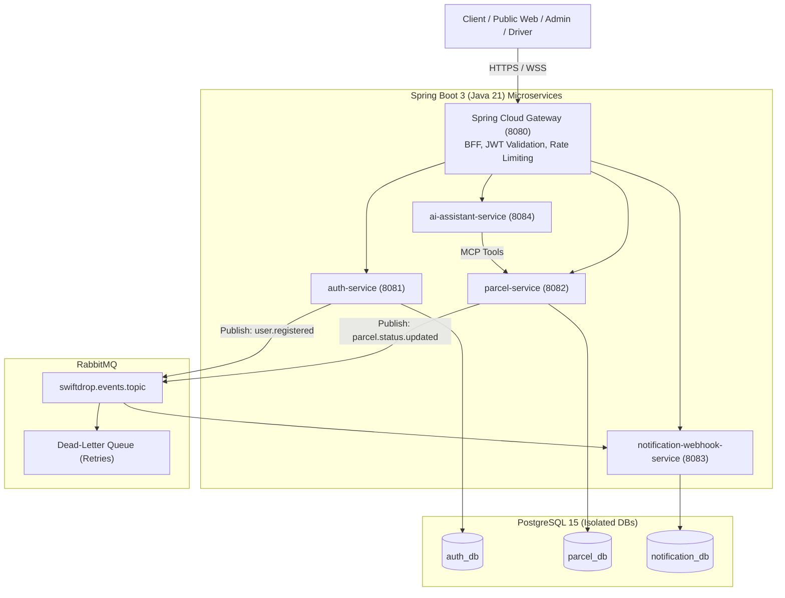
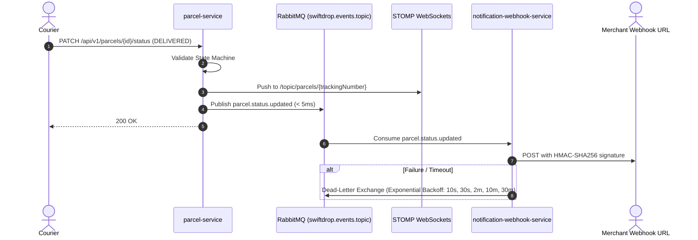
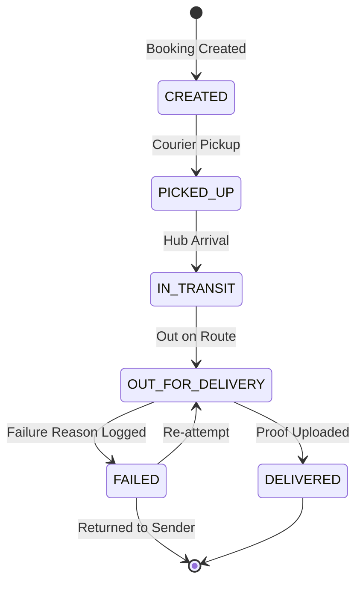

# SwiftDrop Enterprise Platform: Project Master Specification

Authoritative technical specification for the **SwiftDrop (`nyxora-swiftdrop`)** island-wide courier management platform. Reference for developers, AI agents, and architecture workflows.

---

## 1. Executive Summary & Tech Stack

SwiftDrop is a cloud-native microservices platform for automated parcel dispatch, partner e-commerce integrations, and live shipment tracking.

* **Frontend:** Next.js (React), TypeScript, Tailwind CSS, STOMP WebSocket client.
* **API Gateway (Edge):** Spring Cloud Gateway (BFF pattern, JWT validation, RBAC pre-filter, rate limiting).
* **Backend Microservices (Spring Boot 3 / Java 21):**
  * `auth-service` (Port 8081): Local authentication, stateless JWTs, Google OAuth 2.0, merchant OAuth 2.0 client credentials.
  * `parcel-service` (Port 8082): Dynamic pricing (Strategy pattern), courier dispatch, lifecycle state machine, STOMP broker.
  * `notification-webhook-service` (Port 8083): RabbitMQ consumer, email/mock SMS, HMAC-signed merchant webhooks with exponential backoff.
  * `ai-assistant-service` (Port 8084): Spring AI + Model Context Protocol (MCP) tool caller for natural language queries.
* **Databases:** Single PostgreSQL 15 server hosting three isolated databases (`auth_db`, `parcel_db`, `notification_db`).
* **Messaging:** RabbitMQ (Topic Exchange `swiftdrop.events.topic` + Dead-Letter Exchange retry routing).
* **DevOps:** Docker Compose (local dev), Kubernetes (production manifests with Ingress, ConfigMaps, Secrets, StatefulSets), GitHub Actions.



---

## 2. Monorepo Directory Structure

```text
nyxora-swiftdrop/
├── .github/workflows/            # CI/CD pipelines
├── docs/                         # Architecture specifications & developer guides
├── docker/postgres/              # PostgreSQL multi-db init (init-multi-db.sql)
├── k8s/                          # Kubernetes production manifests & statefulsets
├── frontend/                     # Next.js Application (Portals & Tracking)
├── services/                     # Spring Boot Microservices
│   ├── api-gateway/              # Spring Cloud Gateway (BFF)
│   ├── auth-service/             # Auth, RBAC, OAuth 2.0
│   ├── parcel-service/           # Booking, Pricing Engine, State Machine, WebSockets
│   ├── notification-webhook-service/ # RabbitMQ consumer, SMS/Email, HMAC webhooks
│   └── ai-assistant-service/     # Spring AI + MCP client
├── .env.example
├── docker-compose.yml
└── README.md
```

---

## 3. Use Case Catalogue

| Actor | ID | Title | Summary | Service |
| :--- | :--- | :--- | :--- | :--- |
| **Public** | `UC1` | Track Parcel | Unauthenticated live tracking timeline via tracking number. | `parcel-service` |
| **Public** | `UC2` | AI Delivery Assistant | Natural language inquiries for fee estimates and tracking status. | `ai-assistant-service` |
| **Customer** | `UC3` | Email/Password Auth | Registration and login issuing stateless JWTs. | `auth-service` |
| **Customer** | `UC4` | Google OAuth 2.0 | One-click social login via Google Identity Services. | `auth-service` |
| **Customer** | `UC7` | Calculate Rate Quote | Dynamic fee quotes by weight, size, origin, and destination zones. | `parcel-service` |
| **Customer** | `UC8` | Create Parcel Order | Book package pickup/delivery, generate tracking code. | `parcel-service` |
| **Customer** | `UC9` | Real-Time Tracking | Live delivery milestones pushed via STOMP WebSockets. | `parcel-service` |
| **Customer** | `UC10`| Delivery History | View past shipments, digital receipts, and delivery proofs. | `parcel-service` |
| **Merchant** | `UC5` | Merchant Registration | Submit business details and webhook URLs awaiting admin approval. | `auth-service` |
| **Merchant** | `UC6` | Client Credentials Auth | Machine-to-machine OAuth 2.0 token acquisition. | `auth-service` |
| **Merchant** | `UC11`| Bulk Parcel API | Programmatic bulk order creation via REST API. | `parcel-service` |
| **Merchant** | `UC12`| Signed Webhooks | Receive HMAC-SHA256 signed event updates with automatic retries. | `notification-webhook-service` |
| **Merchant** | `UC13`| Merchant Dashboard | Order analytics, delivery success metrics, and webhook logs. | `frontend` |
| **Courier** | `UC14`| View Daily Runsheet | Mobile list of assigned pickups and drop-offs for the shift. | `parcel-service` |
| **Courier** | `UC15`| Advance Parcel Stage | Guarded milestone progression (`PICKED_UP` → `IN_TRANSIT` → `DELIVERED`). | `parcel-service` |
| **Courier** | `UC16`| Upload Delivery Proof | Capture recipient name, signature, and proof photo. | `parcel-service` |
| **Courier** | `UC17`| Log Delivery Failure | Record structured failure reasons (e.g., `RECIPIENT_UNAVAILABLE`). | `parcel-service` |
| **Admin** | `UC18`| Dispatch & Assignment | Manual or automated assignment of parcels to available couriers. | `parcel-service` |
| **Admin** | `UC19`| Courier Workload Monitor | Real-time tracking of active courier capacity and assigned zones. | `parcel-service` |
| **Admin** | `UC20`| Account Approvals | Approve or reject pending merchant and courier applications. | `auth-service` |
| **Admin** | `UC21`| Zone & Pricing Config | Configure delivery districts, base fees, and per-kg multipliers. | `parcel-service` |
| **Admin** | `UC22`| Operational Analytics | Island-wide delivery performance, SLA adherence, and volume stats. | `parcel-service` |

---

## 4. Multi-Database Architecture & Schemas

Three isolated logical databases enforce service boundaries while sharing one PostgreSQL instance:

```mermaid
erDiagram
    %% auth_db
    ROLES ||--o{ USERS : "has"
    USERS ||--o| MERCHANTS : "has"
    USERS ||--o| COURIERS : "has"

    ROLES { int id PK, string name UK }
    USERS { uuid id PK, int role_id FK, string email UK, string password_hash, string auth_provider }
    MERCHANTS { uuid id PK, uuid user_id FK, string oauth_client_id UK, string webhook_url, string webhook_secret }
    COURIERS { uuid id PK, uuid user_id FK, string vehicle_type, string license_plate UK, int active_delivery_count }

    %% parcel_db
    DELIVERY_ZONES ||--o{ PRICING_RULES : "origin/dest"
    DELIVERY_ZONES ||--o{ PARCELS : "origin/dest"
    PARCELS ||--o{ PARCEL_STATUS_HISTORY : "tracks"

    DELIVERY_ZONES { int id PK, string zone_code UK, string zone_name, decimal base_surcharge }
    PRICING_RULES { int id PK, int origin_zone_id FK, int destination_zone_id FK, decimal base_fee, decimal rate_per_kg }
    PARCELS { uuid id PK, string tracking_number UK, uuid assigned_courier_id, string current_status, decimal estimated_fee }
    PARCEL_STATUS_HISTORY { uuid id PK, uuid parcel_id FK, string status, string proof_photo_url, string failure_reason }

    %% notification_db
    WEBHOOK_DELIVERY_LOGS { uuid id PK, uuid parcel_id, uuid merchant_id, int retry_count, string delivery_status }
```

### Logical Database Summary

| Database | Service | Core Tables | Key Responsibilities |
| :--- | :--- | :--- | :--- |
| **`auth_db`** | `auth-service` | `roles`, `users`, `merchants`, `couriers` | User accounts, BCrypt credentials, RBAC roles, OAuth2 client credentials, courier availability & workload counters. |
| **`parcel_db`** | `parcel-service` | `delivery_zones`, `pricing_rules`, `parcels`, `parcel_status_history` | Zone matrices, pricing rules, parcel bookings, tracking codes (`SD-YYYYMMDD-XXXXXX`), immutable status history. |
| **`notification_db`** | `notification-webhook-service` | `webhook_delivery_logs` | Merchant webhook dispatch logs, JSON payloads, retry counters (max 5), delivery status (`PENDING`, `DELIVERED`, `RETRYING`, `DEAD_LETTER`). |

> **Rule:** No service directly queries another service's database. Cross-boundary updates happen strictly via REST or RabbitMQ events.

---

## 5. Integration Patterns & Messaging



* **Synchronous REST / HTTPS:** Transactional operations (login, booking creation, rate calculation).
* **Asynchronous Pub/Sub (RabbitMQ):** Topic exchange `swiftdrop.events.topic` dispatches immutable domain events (`parcel.created`, `parcel.status.updated`, `user.registered`).
* **Signed Webhooks & DLQ:** Outbound merchant webhooks include `X-SwiftDrop-Signature` (HMAC-SHA256). Failures retry up to 5 times across exponential intervals via RabbitMQ Dead-Letter Exchanges.
* **STOMP WebSockets:** Real-time push to `/topic/parcels/{trackingNumber}` for active shipment tracking.
* **Spring AI + MCP Tools:** `ai-assistant-service` invokes `get_parcel_status_by_tracking_number` and `calculate_delivery_rate_quote` via strongly-typed MCP interfaces.

---

## 6. Design Patterns & Security Guardrails

### 6.1 Design Patterns
* **Strategy Pattern:** Dynamic fee computation via `PricingStrategy` (`StandardZonePricingStrategy`, `MerchantDiscountPricingStrategy`).
* **Guarded State Machine:** Strictly controls parcel lifecycle transitions. Invalid transitions throw `InvalidStateTransitionException`:



* **Observer Pattern:** RabbitMQ event fan-out to email, SMS, and analytics consumers.
* **Repository Pattern:** Spring Data JPA abstractions for data isolation.

### 6.2 Security Guardrails
* **Stateless JWTs:** Signed tokens carrying user UUID and role claims (`ROLE_CUSTOMER`, `ROLE_MERCHANT`, `ROLE_COURIER`, `ROLE_ADMIN`).
* **RBAC & `@PreAuthorize`:** Fine-grained authorization (e.g., Couriers can only update assigned parcels; merchants can only access their own shipments).
* **Secret Hashing:** Passwords and merchant client secrets stored as **BCrypt (strength 12)** hashes.
* **Input Validation:** Jakarta Bean Validation (`@Valid`, `@NotNull`, `@NotBlank`) enforced at all API boundaries.
* **Error Sanitization:** Centralized `@RestControllerAdvice` masks stack traces into RFC 7807 problem payloads and scrubs PII from logs.
